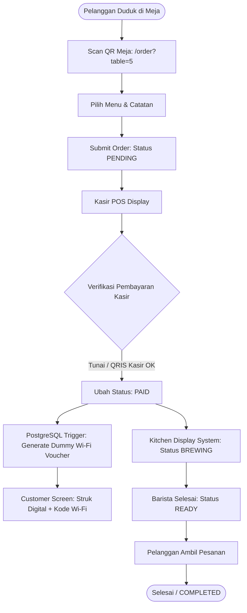
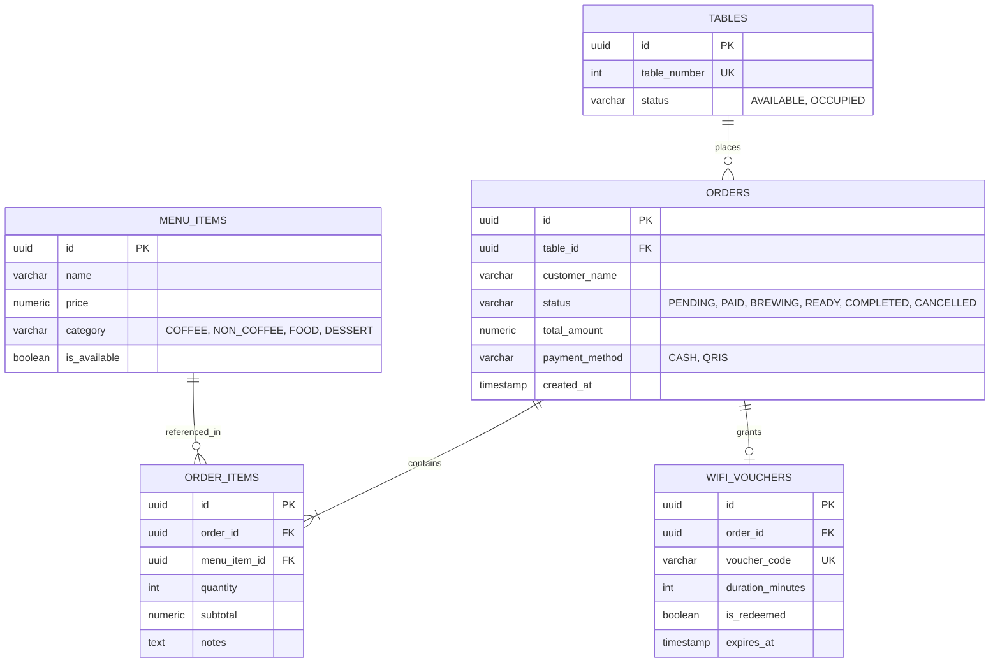

# ☕ ScanNGo Cafe - Smart QR-POS & Table Management System

[](https://vercel.com) [](./docs/PRD.md)

**Project Documentation:** [PRD.md](./docs/PRD.md)

> **Role Showcase:** System Analyst & Solution Architect  
> **Target Environment:** Fast-casual Cafes / Self-service F&B  
> **Tech Stack:** Next.js (Frontend), Supabase (PostgreSQL + Realtime), PostgreSQL Triggers & Views

---

## 1. Problem Statement & System Solution

### Problem Analysis
Banyak UMKM cafe menggunakan QR Code statis di meja yang sekadar membuka PDF menu atau formulir Google Form. Model ini menimbulkan masalah kritis:

| No | Problem | Impact |
| :--- | :--- | :--- |
| 1 | **Order Fiktif** — Siapa pun bisa submit pesanan dari luar cafe tanpa validasi lokasi | Revenue loss, inventory distortion |
| 2 | **Rekonsiliasi Manual** — Kasir hitung omzet dari struk kertas manual | Time waste, human error |
| 3 | **No Value-Add** — Tidak ada integrasi fasilitas cafe dengan nilai belanja | Customer retention loss |

### System Architecture Overview
Sistem POS web-based terintegrasi yang:

- **Validasi Lokasi Meja** — Order hanya valid saat di-SCAN dari QR code di dalam cafe (IP-based verification)
- **Realtime Synchronization** — Supabase Realtime CDC tanpa WebSocket manual untuk kasir ↔ barista sync
- **Database-Aggregated Analytics** — Sales recap dihitung via PostgreSQL Views (bukan backend computation)
- **Wi-Fi Voucher Integration Ready** — Trigger-based token generation untuk MikroTik RouterOS API

---

## 2. End-to-End Order Flow



---

## 3. Entity Relationship Diagram



---

## 4. Technical Architectural Decisions

### Why Supabase Realtime (CDC without WebSocket)
| Approach | Complexity | Scalability | Cost |
| :--- | :--- | :--- | :--- |
| Custom WebSocket Server | High (connection management, load balancing) | Limited (single server bottleneck) | $$$$ |
| Supabase Realtime | **Low** (managed infrastructure) | **High** (Postgres-level CDC) | **Free tier available** |

**Implementation:** Supabase Realtime channel `postgres_changes` pada tabel `orders` push update ke KDS & POS client tanpa polling.

### Why PostgreSQL Triggers & Views
| Layer | Computation Cost | Cache Validity | Developer Overhead |
| :--- | :--- | :--- | :--- |
| Frontend Computation | High (recompute on every render) | Stale after refresh | High (duplicate business logic) |
| Backend Computation | Medium (cache invalidation needed) | Stale without WebSockets | Medium |
| **Database View + Triggers** | **Negligible (indexed)** | **Realtime** | **Low (declarative SQL)** |

**Example:** `sales_recap` view agregasi daily/weekly omzet tanpa backend query.

### Wi-Fi Voucher Mocking Layer
Production implementation menggunakan MikroTik RouterOS API atau FreeRADIUS. Di portofolio ini, diimplementasikan:

1. **Database Table:** `wifi_vouchers` dengan `voucher_code` (6-char alphanumeric)
2. **Trigger:** Auto-generate saat `orders.status = 'PAID'`
3. **API Endpoint:** `/api/voucher?code={code}` (mock Radius server simulation)

**Upgrade Path:** Replace trigger logic dengan `supabase.edgeFunction()` yang call MikroTik REST API.

---

## 5. Demo Route Walkthrough

### `/order?table=5` — Customer PWA
| Feature | Implementation |
| :--- | :--- |
| Table Validation | Query `tables` table dengan `table_number=5` |
| Cart Management | React `useState` + `useEffect` untuk fetch menu |
| Order Submission | Insert `orders` + `order_items` via Supabase client |
| Success State | Render struk digital + kode Wi-Fi voucher |
| Realtime Updates | N/A (single-submit workflow) |

### `/pos` — Cashier Verification & Wi-Fi Generator
| Feature | Implementation |
| :--- | :--- |
| Order Filter | View `kitchen_queue` filter status `PENDING`, `PAID` |
| Payment Verification | Update `orders.status` → `PAID` |
| Wi-Fi Voucher Generation | Query `wifi_vouchers` where `order_id` = current order |
| Voucher Code Display | Render 6-char code + countdown expiration |

### `/kds` — Kitchen Order Pipeline
| Feature | Implementation |
| :--- | :--- |
| Realtime Queue | Supabase channel `kds_orders` subscribe `postgres_changes` |
| Status Pipeline | `PAID` → `BREWING` → `READY` → `COMPLETED` |
| Order Details | Join `orders` + `order_items` + `menu_items` via view |
| Visual Status | Color-coded border (yellow=PAID, orange=BREWING, green=READY) |

### `/admin/recap` — Automated Sales Aggregation
| Feature | Implementation |
| :--- | :--- |
| Daily Recap | Query view `sales_recap` GROUP BY `DATE(created_at)` |
| Weekly Recap | PostgreSQL `DATE_TRUNC('week', created_at)` |
| Chart Rendering | Chart.js integration untuk revenue trend |
| Export to CSV | CSV stringification di frontend (no backend dependency) |

---

## 6. Local Development Quickstart

### Prerequisites
- Node.js 18+
- Supabase CLI (optional, untuk local DB dev)

### Setup Steps

```bash
# 1. Clone repo
git clone https://github.com/<username>/ScanNGo-Cafe.git
cd ScanNGo-Cafe/src/frontend

# 2. Install dependencies
npm install

# 3. Create .env.local
echo "NEXT_PUBLIC_SUPABASE_URL=https://<project-id>.supabase.co" > .env.local
echo "NEXT_PUBLIC_SUPABASE_ANON_KEY=<anon-key>" >> .env.local

# 4. Run dev server
npm run dev
```

### Available Scripts
| Command | Purpose |
| :--- | :--- |
| `npm run dev` | Start local dev server (port 3000) |
| `npm run build` | Production build (Vercel compatible) |
| `npm run start` | Serve production build |
| `npm run lint` | ESLint check |

---

## 7. Project Status & Roadmap

### ✅ Implemented
- QR code table validation (`/order?table=X`)
- Customer order flow (menu selection, cart, submit)
- Realtime KDS with status pipeline (PAID → BREWING → READY → COMPLETED)
- Cashier POS with payment verification
- Wi-Fi voucher auto-generation via PostgreSQL trigger
- Admin recap dashboard (daily/weekly aggregated view)

### 🚧 In Progress
- Mock Wi-Fi Radius API endpoint (`/api/voucher`)
- Table QR code generation (dynamic SVG)

### 📋 Future Scope
- MikroTik RouterOS API integration (production Wi-Fi)
- Tailscale network verification (IP-based location check)
- Multi-store support dengan store-specific QR codes

---

**License:** MIT  
**Author:** System Analyst & Solution Architect Portfolio Project
