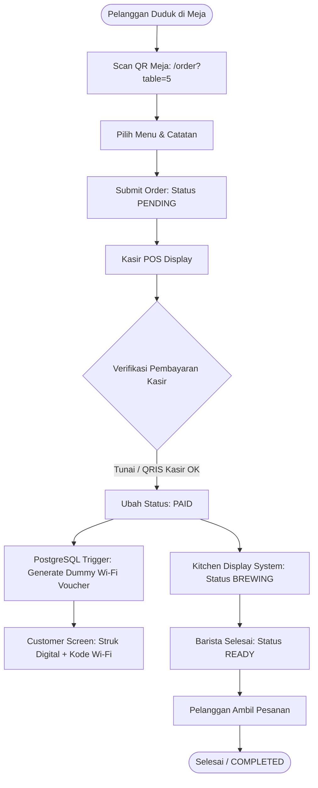
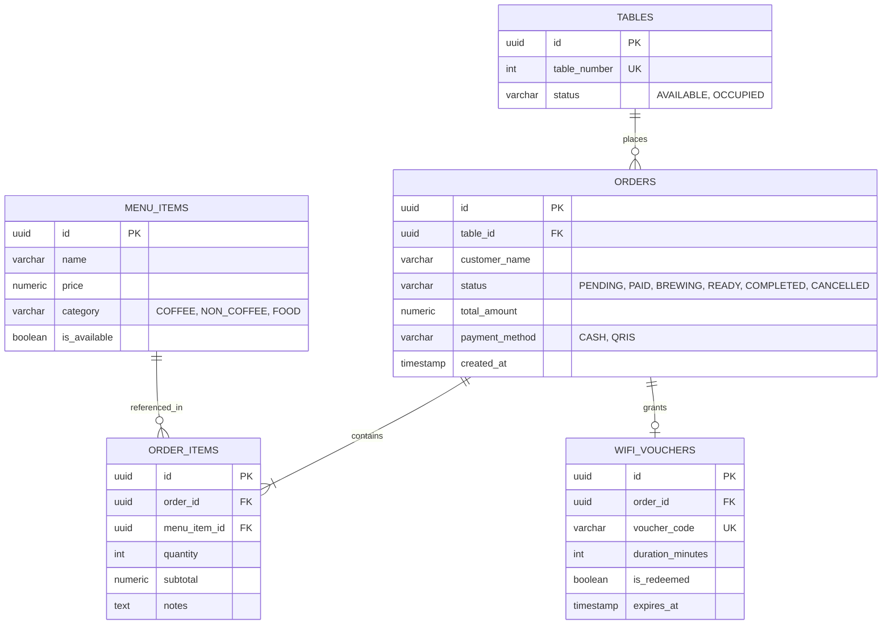

# ☕ ScanNGo Cafe - Smart QR-POS & Table Management System

> **Role Showcase:** System Analyst & Solution Architect  
> **Target Environment:** Fast-casual Cafes / Self-service F&B  
> **Tech Stack:** Next.js (Frontend POS & Customer View), Supabase (PostgreSQL + Realtime), Tailscale/Mock API (Wi-Fi Voucher Simulation).

---

## 1. Executive Summary & Problem Statement

### 1.1 Background
Banyak UMKM cafe menggunakan QR Code statis di meja yang sekadar membuka PDF menu atau formulir Google Form. Model ini menimbulkan masalah:
1. **Order Fiktif**: Siapa pun yang memiliki link meja bisa melakukan submit pesanan dari luar cafe.
2. **Rekonsiliasi Manual**: Kasir harus menghitung omzet harian manual dari struk kertas.
3. **Value Proposition Rendah**: Tidak ada integrasi fasilitas cafe (seperti kuota internet Wi-Fi) dengan nilai belanja pelanggan.

### 1.2 Proposed Solution
Sistem POS web-based terintegrasi yang memvalidasi pesanan meja, sinkronisasi pesanan ke Barista secara realtime via Supabase Webhooks, menyajikan rekap analitik penjualan otomatis via PostgreSQL Views, dan mengeluarkan dummy voucher Wi-Fi (arsitektur disiapkan untuk MikroTik RouterOS API).

---

## 2. Business Process & User Journey (BPMN / Flowchart)



---

## 3. System Architecture & Tech Decisions (SA Perspective)

```mermaid
graph LR
    subgraph Client Tier
        Cust[Customer Mobile PWA]
        POS[Cashier / Admin Dashboard]
        KDS[Kitchen Display System]
    end

    subgraph Backend Tier (100% Free / Serverless)
        Supa[(Supabase PostgreSQL)]
        Realtime[Supabase Realtime Channel]
        EdgeFunc[Supabase Edge Functions / Next API]
    end

    subgraph Simulation Layer
        MockRouter[Mock Wi-Fi Voucher Service\n(Radius/MikroTik Simulation)]
    end

    Cust -->|Submit Order| EdgeFunc
    EdgeFunc -->|Insert Data| Supa
    Supa -->|CDC / Event Trigger| Realtime
    Realtime -->|Push Update| KDS
    Realtime -->|Push Update| POS
    EdgeFunc -->|Generate Token| MockRouter
```

### Justifikasi Arsitektur:
- **Database (Supabase PostgreSQL):** Gratis, support ACID compliant, dan memiliki fitur Realtime Change Data Capture (CDC) untuk sinkronisasi kasir dan dapur tanpa setup WebSockets manual.
- **Wi-Fi Voucher Simulation:** Di production menggunakan MikroTik API/FreeRADIUS. Di portofolio, diimplementasikan via database table trigger `wifi_vouchers` dengan logic token 6-karakter acak.

---

## 4. Entity Relationship Diagram (ERD)



---

## 5. Functional Requirements (FR)

| Code | Module | Deskripsi |
| :--- | :--- | :--- |
| **FR-01** | Table Order | Customer dapat memilih item dan submit order berdasarkan parameter meja (`?table=X`). |
| **FR-02** | Payment Validation | Kasir memverifikasi pembayaran pelanggan sebelum status pesanan beralih ke `PAID`. |
| **FR-03** | Auto Wi-Fi Gen | Sistem men-generate 1 kupon Wi-Fi (6 digit alphanumeric, masa aktif 120 menit) saat order berstatus `PAID`. |
| **FR-04** | Kitchen Display | Layar dapur menampilkan antrian realtime pesanan yang berstatus `PAID` dan `BREWING`. |
| **FR-05** | Daily/Weekly Recap | Dashboard admin menampilkan ringkasan omzet otomatis menggunakan agregasi Database View. |

---

## 6. Database Automation & Analytics (PostgreSQL DDL)

### 6.1 Database View: Automated Sales Analytics
Menghindari load berat di backend, agregasi dihitung langsung di database level:

```sql
-- View Rekapitulasi Harian & Mingguan
CREATE OR REPLACE VIEW sales_recap AS
SELECT 
    DATE(created_at) AS order_date,
    COUNT(id) AS total_transactions,
    SUM(total_amount) AS gross_revenue,
    AVG(total_amount) AS average_basket_size
FROM orders
WHERE status IN ('PAID', 'COMPLETED')
GROUP BY DATE(created_at)
ORDER BY order_date DESC;
```

### 6.2 Trigger: Auto-Generate Wi-Fi Voucher on Payment
```sql
CREATE OR REPLACE FUNCTION generate_wifi_voucher()
RETURNS TRIGGER AS $$
BEGIN
    IF NEW.status = 'PAID' AND OLD.status = 'PENDING' THEN
        INSERT INTO wifi_vouchers (order_id, voucher_code, duration_minutes, expires_at)
        VALUES (
            NEW.id,
            UPPER(SUBSTRING(MD5(RANDOM()::TEXT) FROM 1 FOR 6)),
            120,
            NOW() + INTERVAL '120 minutes'
        );
    END IF;
    RETURN NEW;
END;
$$ LANGUAGE plpgsql;

CREATE TRIGGER trg_generate_wifi_voucher
AFTER UPDATE ON orders
FOR EACH ROW
EXECUTE FUNCTION generate_wifi_voucher();
```

---

## 7. Hardware & Network Integration Blueprint (Future Scope)

Untuk implementasi enterprise dengan router fisik:
```
[Order PAID Event]
       │
       ▼
[Supabase Webhook / Next API]
       │
       ▼
[MikroTik RouterOS API / FreeRADIUS]
  Command: /tool/user-manager/user/add
  Params : username={voucher_code}, uptime-limit=2h
```
